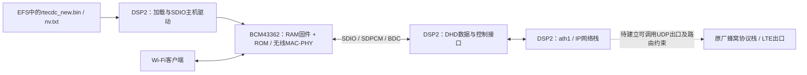

# DSP2 Wi-Fi加载、控制、收发接口逆向

2026-10-28；对象为本机 UV310 的 MDM9K-ALKU-7.3.2 固件。**已形成静态接口地图，尚不是可部署SDK。**硬件仍不在，没有调用下面的地址、加载DSP2代码或改写设备。

本轮复核了完整code切片哈希、分析ELF的整个`.text`与原始切片一致性、142个指定地址指令、11个字符串和1个数据字。证据见[dsp2-api-static.json](../outputs/uv310-wireguard/evidence/dsp2-api-static.json)，可复现工具见[audit.py](../work/uv310-wireguard/dsp2-api/audit.py)。现代LLVM反汇编不是经过验证的Hexagon v3执行模型；下面签名均为逆向命名与推断，不能直接转成任意上下文调用。

## 1. 谁负责什么

DSP2镜像包含DHD/SDIO主机驱动、IP网络栈、Wi-Fi初始化与固件文件读取逻辑。BCM43362执行自身RAM固件及ROM服务，负责芯片内无线功能。DSP2负责主机侧控制/搬运，并不执行BCM的Thumb-2代码；把文件传到BCM RAM也不是给DSP2加载程序。



DSP2还包含LTE RRC/MAC/PDCP和ML1相关静态线索，不能视为独立空闲应用核。DSP1只有64KiB头部副本，职责未查清；详见[执行环境分工证据](DSP_ROLES.md)。Wi-Fi“收发API”与“蜂窝UDP API”是两件事，后者尚未建立。

## 2. 固件加载链

普通启用链的静态交叉引用：`0xcf5e18`内`0xcf5e64 → 0xcf5b04`，初始化内`0xcf5ca8 → 0xcf8930 → 0xcf84e4`。`0xcf8930`记录参数后尾跳主下载函数；对应日志名为`dhdsdio_godo_download_firmware`。

| 阶段 | 位置与已知行为 | 尚未证明 |
|---|---|---|
| 进入下载态 | `0xcf8500 → 0xcf7edc(bus,1)` | 完整复位/时钟寄存器语义、失败后的可恢复状态 |
| 选择镜像 | `gp+0x8198`为0选`/SyFi/brew/mod/rtecdc.bin`，非0选`/SyFi/brew/mod/rtecdc_new.bin` | 不能将所有非零revision一概等同于市场命名a2 |
| 选择值来源 | `0x171c384`提取识别字bits16..19；`0x171c3ac`写入上述全局值 | 芯片识别寄存器读取全链仍需继续核验 |
| 文件接口 | `0x117f96c`打开，`0x117f8e4`读取，`0x117f728`关闭 | EFS底层存储服务在哪个核执行、其RPC与锁语义 |
| 下载循环 | 每次请求最多2048B；仅在读取计数大于0时传输，使用实际计数、递增BCM地址和主机缓冲位置 | 文件读取失败与全部清理路径；不是公共任意大小加载器 |
| RAM传输 | `0xcf85f8 → 0xcf6610(bus,1,address,buffer,count)` | runtime bus句柄、并发互斥和调用时机 |
| NVRAM | 同函数读取`/SyFi/brew/mod/nv.txt`，`0xc584a0`处理后经`0xcf7e3c`保存变量；退出下载态处理RAM末端变量/长度token | 不修改或公开本机NVRAM内容；完整变量约束未审完 |
| 退出下载态 | `0xcf8878 → 0xcf7edc(bus,0)`；`0xcf83c0 → 0xcf8490 → 0x171b954`为core启动/复位相关链 | 最末寄存器序列和所有芯片分支未验证 |
| 初始化继续 | `0xcf5cac`检查下载结果，继续`0xcfb774`及bus状态检查 | 下载完成不等于Wi-Fi已关联或可转发 |

`0xcf6610`的候选签名为`int membytes(bus, write_flag, bcm_addr, host_buffer, size)`，`write_flag=1`写，0读。它按32KiB backplane窗口处理地址，经`0xcf6594`切窗，再调用`0xc569c4 → 0xc57324`进行底层搬运。它是BCM内存访问通路，不能用它直接写DSP2地址。SDIO的具体CMD53参数、实际总线宽度/时钟和DMA/cache要求未完整核验。

长度token的静态路径包含字节数转word数、反码和高16位组合，写在RAM末端减4；它不是WireGuard密钥或加密校验。`0xcf84e4`返回前取低8位；普通初始化以0继续，另一个devreset调用点的分支解释有待审计，因此不把它包装为统一的bool API。本轮也没有证明“修改后任意固件均被接受”；既有BCM补丁的历史成功与DSP2可执行入口无关。

## 3. 从Wi-Fi接收：借用帧 → 复制 → 环形队列 → IP栈

| 内部位置 | 候选参数/行为 | 所有权和限制 |
|---|---|---|
| `0xcf4b38` | `rx(driver, ifidx, chain, count)`；packet`+0`下一项、`+16`数据、`+24`长度 | 原驱动链；不能保留裸指针做异步加密 |
| `0xcf4c68 → 0xf74428` | 普通帧传入`r0=frame,r1=len` | 同步借用源帧；`0x886c`事件走独立路径 |
| `0xf7455c → 0xf777e4` | 从`[gp+0xab84]+0x2c0`的ath1环取得当前预分配包 | 满/空slot可能得到NULL；未证明多生产者安全 |
| `0xf7447c..0xf7450c` | 对齐目的数据位置；先复制12B MAC地址，再复制余下内容 | 有剩余空间不足时的截断路径，不能把它当有界验证过的通用注入器 |
| `0xf74514 → 0xf777d4` | 复制完成后递增producer | slot数据先写，后发布；内存屏障与跨核可见性未验证 |
| `0xf74530 → 0x13cf048` | 条件满足时用`0x400`触发网络处理 | 不能在未知IRQ/锁上下文直接调用 |
| `0xf74378` | 按预算取包，经`0xf77994`后调用`0xf77fc4(...,1)` | 后者普通路径交给`0xced798`；协议栈后续处理待展开 |
| `0xcf4c90 → 0x141593c` | 处理完释放原DHD链 | IPnet持有的是复制后的对象，不是原链 |

环形结构相对ath1私有区：`+0x30 producer`、`+0x34 consumer`、`+0x38 slots[256]`。索引用低8位。`0xf77994`取消费槽，并尝试分配替代包；分配失败时重置旧包并丢弃该帧，消费索引仍推进。不能把256槽理解为256个永远可用的大包缓冲，也没有实测其吞吐或内存开销。

独立packet append helper `0x1714844`修改tail及length，返回原tail。溢出路径可见日志，但没有在这段看到回滚/拒绝；自编适配层必须自行检查容量，不能依赖它保护边界。`0xf74428`返回值并非覆盖所有丢包原因的可靠状态，原RX调用者也没有检查它。

## 4. 发往Wi-Fi：两种对象，不能混用

调用链：`0xf74344(ipnet_packet) → 0xcf49f0(NULL,data,len) → 0x14159c8 → 0xcfef88 → 0xcfd50c`。

| 内部位置 | 候选API语义 | 返回/所有权 |
|---|---|---|
| `0xf74344` | 从IPnet包`+0x98`取data、`+0x4c`取length，条件满足时发送 | 始终经过`0x1714bb4`释放一个输入引用；随后返回0，底层错误丢失 |
| `0xcf49f0` | `tx_copy(driver_or_null, frame, len)`；NULL用`gp+0x8170`全局driver | 源帧同步复制，调用者仍拥有源帧；无就绪状态可返回4，分配失败-1，后续传递bus结果 |
| `0x14159c8` | 新建DHD packet并复制源数据；`0x1415afc`最终进入copy例程 | 分配器上限检查`0x2200`只是此处上限，不是安全MTU；headroom来自运行配置 |
| `0xcfef88` | 前推4B BDC头：`0x20`、priority低3位、ifidx、0 | 本发送调用使用ifidx=0；不能手工把IPnet对象当DHD对象传入 |
| `0xcfd50c` | 额外前推12B供总线头，向优先级队列提交 | 正常接受返回0；拒绝路径恢复12B偏移并释放新DHD包，返回-22；接受不等于空口送达 |
| `0xd01754` | 有界优先级队列接纳逻辑 | 可能先淘汰并释放旧包再接纳新包；不能只统计新提交失败数作为全部丢包 |

`0x1714bb4`对IPnet包`+0xa0`的引用数处理，包含原子减和最终释放路径；这不是DHD释放器。`0x141593c`则按DHD链/分配对象释放。接口层不得交叉使用两个free函数。

BDC结构与公开Broadcom驱动一致，仅用于协议对照；并未移植其Linux `sk_buff` ABI。[公开内核dhd_cdc.c](https://android.googlesource.com/kernel/common/+/8a2cf062b27ef5511a7d8a7ce6662fbc04f671b8/drivers/net/wireless/brcm80211/brcmfmac/dhd_cdc.c)

## 5. 控制面：三个层次与三个返回值约定

| 层次 | 位置 | 布局/行为 |
|---|---|---|
| 配置操作数组 | `0xcf5754 → 0xcf4e8c` | 每项8B：operation、value指针；逐项执行，遇0停止；全部非零则返回1；41项跳转表见旧driver ABI证据 |
| WL包装 | `0x17f4610` | `(command,buffer,len,set)`；清空28B IOCTL结构，填`+0/+4/+8/+12`，保留`+24=0`；经thunk`0x17f4660 → 0xcf5788`；负值映射-2，否则0 |
| IOCTL路由 | `0xcf5788` | `+24 == 0x00444944`进host DHD `0xd015e4`，否则进BCM firmware `0xcffd68`；非空buffer长度封顶8192；负错误映射-1，非负映射0 |
| 任务队列消费者 | Wi-Fi任务`0xcf6014`内`0xcf616c..0xcf61d4` | signal bit3处理queue`0x243c4d0`；request`+8 pairs,+12 count,+16 completion_task,+20 signal,+24 byte result` |

任务消费者写结果后通知completion task。**生产者、分配/释放、超时取消和重入规则还没接齐**，不能只造一个请求结构扔进队列。IOCTL中还有全局状态提前返回0的路径；0不能在所有状态下等价为“实际执行成功”。

历史实机的`AT+WL=wl ver`证明WL到BCM查询路径有效，不证明host DHD内存接口或DSP2代码执行。可选命令表、事件`0x886c`及callback细节见[dsp2-driver-abi.json](../outputs/uv310-wireguard/evidence/dsp2-driver-abi.json)和[bridge-static.json](../outputs/uv310-wireguard/evidence/bridge-static.json)。

## 6. 回调注册与Hexagon并行语义

ath1构造路径`0xf77a7c`匹配名字`ath1`后，把`0xf74344`写到私有区`+0x468`，`0xf74378`写到`+0x464`。全局netif保存在`gp+0xab84`。注意`0xf77b24..0xf77b2c`同一个instruction packet中有`r1=1`和`store r1`；store读的是旧值`0xf74344`，不是1。这是已加入自动检查的一个具体反汇编陷阱。

这些字段可用于后续定位回调表和运行期句柄；本轮没有替换指针，也没有证明任意代码可在该任务中被加载。BCM事件callback与普通数据路径不同，不能拿事件callback当所有帧的RX hook。

## 7. 自编适配层应该暴露什么

[abi_draft.h](../work/uv310-wireguard/dsp2-api/abi_draft.h)只提供32位地址字段的布局视图与偏移断言，没有函数地址绑定，不是可执行SDK。以下是拟定的自编接口，不是假称原厂导出了同名函数：

| 拟定接口 | 应保证的语义 | 缺口 |
|---|---|---|
| `wifi_control(request, completion)` | 串行控制、明确结果、缓冲活到completion | 原厂生产/消费和取消规则 |
| `wifi_tx_copy(frame,len)` | 复制借用帧；返回接受/拒绝原因；统计淘汰与提交 | 原厂任务约束、句柄和完整错误映射 |
| `wifi_rx_copy(callback)` | 在源帧释放前有界复制；队列满明确drop | hook入口、上下文、CPU预算 |
| `cellular_udp_send/recv` | 外层UDP经蜂窝出口；收回包交WG；排除隧道路由循环 | socket ABI、PDP/路由绑定、非阻塞/调度语义 |
| `worker_schedule` | 有界运行、不阻塞无线/蜂窝实时任务 | 正常执行入口、任务ABI与资源实测 |

目标路径是客户端IP → WG加密 → 原厂UDP/蜂窝出口，回程反向处理。无需为此重写LTE物理层；也不能仅凭`wan0`字符串就认定找到了可调用的蜂窝send函数。

## 8. 路线决策与下一步

用户追问DSP分工后，本轮结论是：**M3保留为主线，DSP2作为有明确准入条件的备选。**M3有正常执行和历史握手证据，但资源紧张、此前失联未解释。DSP2有更完整网络代码，却没有证据证明资源更富余或可安全加载自编任务。DSP1更缺完整镜像和运行分工证据。

DSP2的下一步优先逆向现有UDP/socket到蜂窝出口、控制请求生产者及正常任务入口。只有建立工具链/调用约定、可恢复RAM加载、缓存同步与资源边界后，才试正常任务内Hello World；随后先做有界计数和帧复制，最后接WG。不会仅因为已找到Wi-Fi下载器就刷写DSP2分区或覆盖原厂基带功能。

当前可交付：加载链、收发/控制候选契约、对象偏移、失败模式、审计工具与明确缺口。尚不可交付：可安全调用的DSP2 SDK、DSP2 Hello World、蜂窝UDP闭环、性能数据或Wi-Fi经DSP2 WireGuard验收。

复现（固件由所有者本地提供，不在公开仓库）：

```sh
python3 work/uv310-wireguard/dsp2-api/audit.py \
  --nand /absolute/path/to/private/nand \
  --objdump /absolute/path/to/llvm-objdump \
  --out .test-results/dsp2-api-static.json
```
