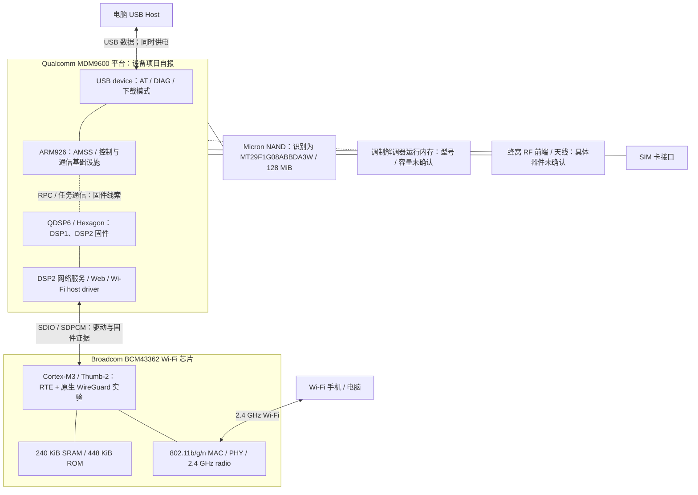

# 硬件架构与芯片信息

这是一份软件可观察的硬件架构说明，面向 ALEKA UV310-U-5.1 CGWL 样机。未拆机、未读取封装丝印，也没有原理图；功能连接不能当作已核验的PCB走线。证据分为：**实机读数**、**固件静态分析**、**厂商芯片规格**、**未确认**。本次整理没有再向设备发送命令。

## 1. 整机功能框图

框图中的 ARM/QDSP/网络服务块是执行职责，不能理解成板上三颗独立外置芯片；BCM 内的 CPU、RAM/ROM、MAC/PHY/radio 也属于同一芯片功能块。DSP1/DSP2是固件分区名，仅凭这两个名字不能完成物理核数量/运行分配的验证。

## 2. 芯片/执行单元清单

| 部件 | 已知信息 | 依据与边界 |
|---|---|---|
| 主平台 | Qualcomm MDM9600；项目响应 MDM9600 UV310 | 实机AT自报；未拆机核丝印。Qualcomm官方将其定位为多模3G/LTE modem，不是本机Linux应用处理器的证明 |
| ARM核 | ARM926，探针MIDR `0x41069265`；下载applet为ARMv5TE | 实机loader寄存器读取与Hello World。正常AMSS另有ARM ELF，不代表只能在下载模式工作 |
| QDSP6 | DSP1/DSP2 ELF `EM_QDSP6`；DSP2按Hexagon v3分析 | 静态ELF/指令与runtime线索；未确认本板各核实际频率或所有任务归属 |
| Wi-Fi | Broadcom BCM43362；live chipnum `0xa962`，chiprev `1` | `wl revinfo`直接读数；当前镜像包含`43362a2-roml`，**a2与chiprev的对应关系未单独验证** |
| Wi-Fi CPU | ARM Cortex-M3，ARMv7-M/Thumb-2 | 厂商数据手册与本机Thumb-2/native运行相互支持 |
| NAND | Micron MT29F1G08ABBDA3W识别名，ID `0x1580a12c`，1 Gbit / 128 MiB标称主数据容量 | loader名称、主动fetch-ID与型号族/几何信息；非整片容量测试，封装后缀未经丝印复核 |
| 外部RAM/PMIC/RF/晶振 | 未确定型号、容量或频率 | 不以同类网卡BOM代替本机证据 |

来源：[实机硬件事实与来源哈希](../outputs/uv310-wireguard/evidence/hardware-facts.json)、[wl读数](../outputs/uv310-wireguard/evidence/wl-runtime-info.json)、[Qualcomm官方MDM9600介绍](https://www.qualcomm.com/news/onq/2012/02/qualcomm-modems-behind-screens-magic)。

## 3. ARM926、QDSP 与 Wi-Fi CPU分别干什么

**ARM926 / AMSS**：AMSS为ARM ELF，入口`0x00100000`；静态字符串包含L4/Pistachio、REX、USB hsu driver、ONCRPC和诊断代码线索。它是系统控制与处理器间通信的参与者，不只是USB外设控制器。已可控的自编代码入口仍是RAM loader；尚未建立与正常原厂网络服务同时运行的通用ARM用户程序入口。

**QDSP6 / DSP固件**：DSP1入口`0x03c00000`、DSP2入口`0x00c00000`。DSP2包含REX/Qube、socket、IP网络、Web ASP、WLAN_TRPWIFI与DHD host driver代码。由固件可定位Wi-Fi收发/控制路径和网络服务；它不是只能做音频的DSP，也不能直接运行ARM Linux ELF。字符串/地址用于推断功能，不替代逐调用链的实机证明。

**BCM Cortex-M3**：运行Broadcom RTE Wi-Fi固件和ROM服务；当前WireGuard正是嵌入这里的freestanding C。它能同时看到Wi-Fi帧和通往modem的SDPCM链路，因而可放置双向hook并借stock蜂窝路径发送WireGuard外层UDP。它并不是板上另加的一颗MCU。

[ELF入口与段元数据](../outputs/uv310-wireguard/evidence/firmware-elf-layout.json)保留虚拟地址、物理地址、文件偏移和各段长度。不要相加ELF段或取最高虚拟地址来推算外部DRAM容量；映射、重叠、保留区都可能影响结论。

## 4. Wi-Fi芯片规格与实机标识

厂商BCM43362资料给出单频2.4GHz、单流802.11b/g/n、SDIO/SPI接口、Cortex-M3、240KB SRAM和448KB ROM；数据手册的芯片能力不意味着该板引出了所有接口或启用了所有模式。本机固件、启动栈界`0x3c000`和完整458752B ROM采集支持其内存结构。本文按实际字节换算写为KiB。[BCM43362厂商数据手册，§1、§7；公开FCC附件中的手册，不是UV310认证报告](https://fcc.report/FCC-ID/2akc5smc01/3324607.pdf)

| `wl revinfo`字段 | 观测值 |
|---|---|
| vendorid / deviceid | `0x14e4` / `0x4343` |
| chipnum / chiprev / chippackage | `0xa962` / `0x1` / `0x9` |
| corerev / radiorev | `0x19` / `0x2064000` |
| boardid / boardvendor / boardrev | `0x598` / `0x14e4` / `P207` |
| phytype / phyrev / anarev | `0x8` / `0x3` / `0x0` |
| driverrev / ucoderev / bus | `0x55a9934` / `0x2aa0066` / `0x0` |

这些ID属于不同命名空间；不要把deviceid `0x4343`解读为另一款同名芯片，也不要只用bus枚举`0x0`猜物理连接。SDIO判断综合了driver调用、下载路径和镜像标识；板上总线宽度与实际时钟没有测量。

`wl cap`实测含ap/sta/wme/ampdu等能力标记，不代表这些能力都做过功能验收；其中`btamp`也不能证明存在可用的独立蓝牙收发功能。GPS字符串同样不能证明天线、RF和定位应用链完整可用。

厂商资料列出面向Wi-Fi安全的AES/TKIP硬件卸载；这不等于已经有WireGuard的ChaCha20-Poly1305/X25519硬件加速。当前WireGuard使用公开C实现，本机没有已验证的QCE或通用crypto offload入口。[BCM43362手册，MAC security部分](https://fcc.report/FCC-ID/2akc5smc01/3324607.pdf)

## 5. 总容量、运行内存、可用空间分开记录

| 对象 | 大小 | 说明 |
|---|---:|---|
| NAND标称主数据区 | 128 MiB | 持久存储；不是RAM，也不是EFS当前可用空间 |
| BCM SRAM | 240 KiB = 245760 B | ROM调用栈、固件数据、heap、包缓冲与补丁共用，非全部可分配 |
| BCM ROM | 448 KiB = 458752 B | 完整采集长度已验证；二进制不公开，不算可写扩展内存 |
| stock Wi-Fi RAM image | 193315 B | 文件长度不等于峰值SRAM占用，启动段存在reclaim |
| memory分支的arena | 106012 B | 当次运行allocator管理区 |
| 最后成功快照free payload / 最大块 | 4636 / 4444 B | 失败前采样，不能代表峰值时仍有这么多空间 |
| modem系统DRAM | 未确认 | 没有可靠总容量/颗粒型号信息 |

`rtecdc_new.bin`由modem存储加载至BCM RAM，ROM提供大量运行服务；这解释了小RAM image不是全部程序，也解释了把持久文件回滚后本次RAM实验仍会继续运行。详见[BCM_RUNTIME.md](BCM_RUNTIME.md)。

## 6. NAND识别与分区

主动fetch-ID得到`0x1580a12c`，按小端字节为`2c a1 80 15`。最初仅读ID寄存器曾得到`0x49464e4f`（ASCII ONFI），那是残留签名，不能拿它当厂商/器件ID。读出的loader型号属于Micron 1Gb x8 NAND族；型号族规格可对照[Micron原厂MT29F1G08系列资料页](https://www.micron.com/products/storage/nand-flash/slc-nand/part-catalog/part-detail/mt29f1g08abaeawp-it-e)，该链接的后缀是另一变体，不用于证明本板电压、封装或具体revision。

当前几何：page2048B、64page/block、block131072B。MIBIB表在block2，magic `0x55ee73aa / 0xe35ebddb`、version3、10项。以下是分区元数据，不是写入许可，也不包括分区内容。

| 分区 | 起始block | block数 | 标称长度 |
|---|---:|---:|---:|
| 0:MIBIB | 0 | 10 | 1280 KiB |
| 0:SIM_SECURE | 10 | 6 | 768 KiB |
| 0:FSBL | 16 | 3 | 384 KiB |
| 0:OSBL | 19 | 5 | 640 KiB |
| 0:AMSS | 24 | 27 | 3456 KiB |
| 0:DSP1 | 51 | 27 | 3456 KiB |
| 0:DSP2 | 78 | 293 | 37504 KiB |
| 0:FTL | 371 | 27 | 3456 KiB |
| 0:EFS2QDSP | 398 | 528 | 67584 KiB |
| 0:EFS2 | 926 | 余下区域标记 | 未确定 |

`0xffffffff`块数字段是特殊尾部标记，不是4294967295个实际block；剩余空间、坏块、保留块和EFS可用空间还需各自验证。128MiB是容量识别，不是全片read/write test。未整分区读取SIM_SECURE/FTL/EFS2QDSP/EFS2，未发送NAND program/erase。保留[分区元数据证据](../outputs/uv310-wireguard/evidence/nand-partitions.json)。

## 7. 主机接口与开发边界

USB在本研究中是**设备角色**：正常AT/DIAG、光盘、下载loader；枚举拓扑见[PROTOCOLS.md](PROTOCOLS.md)。没有证据证明板上可以直接启用USB Host/OTG，RNDIS/ECM也不能仅凭芯片能力宣称已配置或已经通过WireGuard。Wi-Fi客户端路径才是已验证的native转发方向。

待补硬件项目：外部RAM颗粒/容量、各核与SDIO实际频率、PMIC/RF器件、天线数量与连接、PCB接口引出、电源电流/热行为、USB实际速率和Host布线、GNSS/蓝牙完整支持情况。用户当前选择软件方式，文档不会把未做的拆机或测量写成确认事实。

2026-10-28补充：DSP2的Wi-Fi加载、收发和控制调用链已整理为[DSP2_API.md](DSP2_API.md)；蜂窝代码线索及DSP1片段覆盖范围见[DSP_ROLES.md](DSP_ROLES.md)。DSP2目前是备选，未建立可调用SDK或正常任务内自编代码入口。
